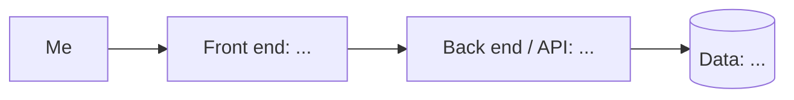

<!--
  Product 1 Spec Template
  Paste this into any document you can save (Google Docs, Word, Notes, a text
  editor). On Wednesday it becomes the README.md of your Product 1 repository.
  Walkthrough, examples, and AI prompts are in the guide:
  https://github.com/464squad/IEL/blob/main/projects/product-1/product-spec-guide.md
  Delete these instructions and the italic hints as you fill each section in.
-->

# Web AAC

> This website provides non-verbal and semi-verbal indiviuals with a free and open source Augmentative and Alternative Communication (AAC) platform.

**Author:** AJ Thompson · **Course:** CMP 464/343 Product 1 · **Last updated:** 10/13/26

---

## 1. About Me (the User)

I am the sibling of a non-verbal child. He requires his iPad in order to communicate with us. However, issues have arose with this method. 

**The last 3 times this happened:**

1. Lack of portability. His iPad does not work on data. It requires wifi and therefore is not able to use outdoors. I would have to use a free AAC app on my phone, but it is not setup the same way as the paid one on our iPad.
2. The device is limited. His school supplies and configures it without providing much guidance or freedom on how to adjust it for our personal use. We usually have to make do with few basic or school-focused options available to us.
3. Setup can be difficult. Navigating for words or getting started with the AAC device can be confusing. The UI can be made more intuitive, but with regular use we have adapted to it.

**What it costs me:**
- ⏱️ Time: Spent on initial setup
- 💸 Money: The cost of an iPad & the AAC application
- 🔋 Energy: Low from struggles with navigating for certain words
- 🙂 Joy: Limited by how hard it can be to communicate effectively

---

## 2. Problem Statement

**Gut check:**

> I need **a free and open source AAC application** because **it makes communication accessible**.

**Five Whys:**
1. The ability to conversate with others opens new opportunities
2. Alternatives to AAC devices such as sign language has a higher learning curve & is not practiced by many
3. Many AAC platforms run on legacy code
4. AAC applications should provide more options for its users
5. Not everyone can afford an iPad and AAC application, which is the common setup

**Problem statement:**

> **When** AAC devices are too restricted,
> **I struggle to** communicate with my brother,
> **which costs me** my joy.
> **This happens because** there are not many free and open source options that can be used cross-platform.
> **Right now I** use the AAC services provided with his iPad, **but** I cannot use it everywhere.

**I'll know this is solved when:** My brother can communicate freely and with ease from any device

<!-- *Check: none of these words appear: app, website, platform, dashboard, tool, AI, track, automate, notify, feature.* -->

---

## 3. Existing Solutions

| What I use or tried | What it does well | Why it falls short *for me* |
|---|---|---|
| My brother's iPad AAC app | | |
| Free AAC app on my phone | | |
| Learning ASL | | |

**The gap:** *In one sentence, what's still missing for me?*

[Your answer]

---

## 4. Features & Benefits

*Every feature should move me toward my "solved when" line.*

| Feature (what it does) | Benefit (how my life gets better) | MVP or Later? |
|---|---|---|
| | | |
| | | |
| | | |
| | | |

**MVP (2–3 features):** *The skateboard: the smallest version I'd actually use.*
- Buttons with images representing common conversational words
- Audio output of the words when those buttons are pressed

**Later:**
- 

**Not doing:** *Things I'm deliberately leaving out.*
- 

---

## 5. Tech Stack

### Front end
- **Surface:** Web
- **Tools:** TypeScript, React, Next.js, Tailwind CSS
- **Why:** Responsive web applications can be used from any device 

### Back end
| Piece | Choice | Why |
|---|---|---|
| Server / API | Node.js | |
| Data storage | PostgreSQL / Supabase | |
| Outside services (optional) | N/A | N/A |
| Hosting / deploy | Vercel | |

### Architecture sketch

---

## 6. Open Questions

*What am I still unsure about? What do I need to figure out or test first?*

- How should I expand to provide access to hundreds or thousands of words, especially as it will hard to do manually on my own?
- What default word options give users enough to work with without being overwhelming?